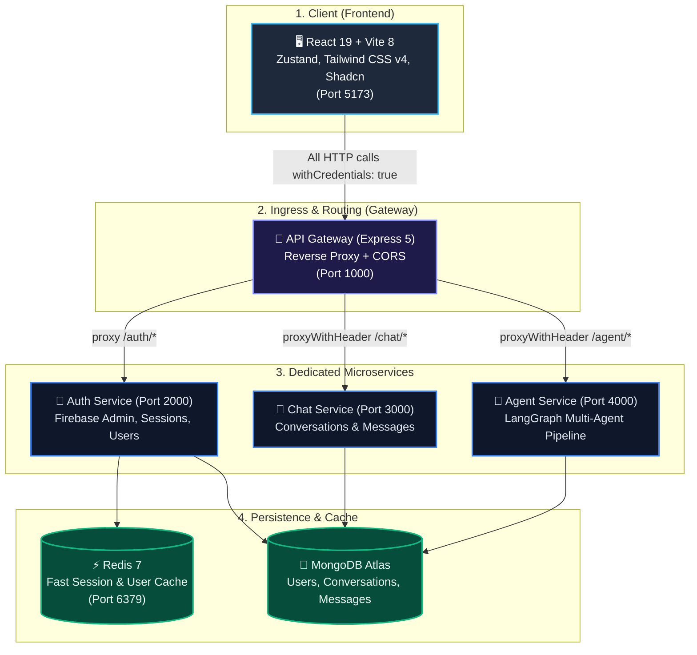
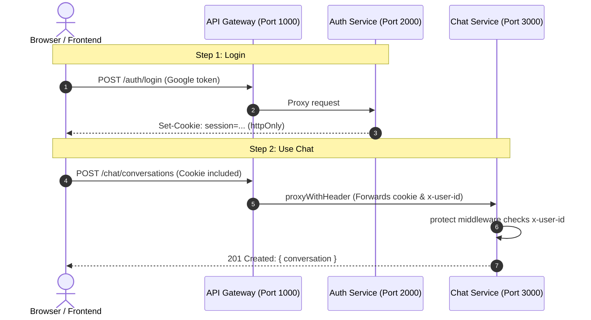
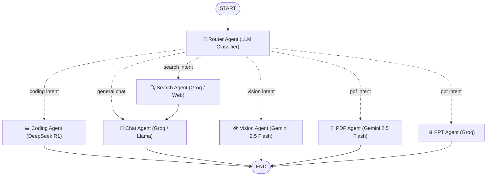

# 🏛️ System Architecture — Agentic AI

Welcome to the **Agentic AI** architecture guide. This document is crafted to be clean, modular, and easy to learn from as you build and scale your full-stack AI platform.

---

## 1. High-Level System Architecture

The platform follows a decoupled **API Gateway + Specialized Microservices** pattern paired with a modern React frontend:



---

## 2. Service Responsibilities & Boundaries (Single Responsibility Principle)

Each service has a single, well-defined job. **Never mix service responsibilities**:

| Service | Port | Primary Job | What It Owns | What It Should NEVER Do |
| :--- | :--- | :--- | :--- | :--- |
| **Frontend** | `5173` | UI & UX | React components, Zustand stores, client Firebase auth | Never query databases directly; all API calls go to Gateway (Port 1000). |
| **Gateway** | `1000` | Ingress Entrypoint | CORS handling, reverse-proxying client requests, forwarding headers | Never query databases or run LLM agents directly. |
| **Auth** | `2000` | Identity & Security | Firebase Admin verification, user profile in MongoDB, Redis session cache | Never handle chat message storage or agent pipelines. |
| **Chat** | `3000` | Chat Management | Conversations and messages persistence in MongoDB | Does **not** need `firebase-admin` or user authentication logic; receives verified `x-user-id` from Gateway. |
| **Agent** | `4000` | AI Reasoning Pipeline | LangGraph orchestration, specialized agents (coding, search, vision, pdf, ppt) | Pure reasoning service; calls LLMs and returns AI responses. |

---

## 3. Clean Microservices Directory Layout

```
Agentic AI/
├── backend/
│   ├── docker-compose.yml              # Local Redis (Port 6379)
│   ├── shared/
│   │   └── redis/redis.js              # Reusable Redis connection client
│   └── services/
│       ├── gateway/ (Port 1000)        # Ingress Reverse Proxy
│       │   ├── configs/db.js           # Shared DB connection
│       │   ├── middlewares/            # errorHandler, notFound
│       │   ├── utils/proxyWithHeader.js# Clean proxy header decorator
│       │   └── index.js                # App entrypoint (routes /auth, /chat, /agent)
│       │
│       ├── auth/ (Port 2000)           # Authentication Microservice
│       │   ├── configs/firebase.js     # Firebase Admin SDK (ONLY here!)
│       │   ├── configs/db.js           # MongoDB connection
│       │   ├── controller/auth.controller.js # login, logout, getMe
│       │   ├── middlewares/auth.middleware.js # Session verification via Firebase/Redis
│       │   ├── model/user.model.js     # Mongoose User model
│       │   ├── routes/auth.route.js    # /login, /logout, /me
│       │   └── utils/                  # ApiError, AsyncHandler, sendResponse
│       │
│       ├── chat/ (Port 3000)           # Chat Management Service
│       │   ├── configs/db.js           # MongoDB connection
│       │   ├── controller/chat.controller.js # createConversation, getConversations
│       │   ├── middlewares/auth.middleware.js # Extracts user identity (x-user-id)
│       │   ├── model/conversation.model.js   # Conversation schema & indexes
│       │   ├── model/message.model.js        # Message schema & indexes
│       │   ├── routes/chat.route.js    # /conversations, /messages
│       │   └── utils/                  # ApiError, AsyncHandler, sendResponse
│       │
│       └── agent/ (Port 4000)          # LangGraph Multi-Agent Orchestrator
│           ├── configs/llmModels.js    # Groq, Google Gemini, DeepSeek configurations
│           ├── configs/db.js           # MongoDB connection
│           ├── controller/agent.controller.js # Receives prompt & runs agentGraph
│           ├── graph/
│           │   ├── state.js            # AgentState schema (prompt, agent, aiResponse)
│           │   ├── router.js           # Intent classification prompt
│           │   └── graph.js            # Compiled StateGraph with START & END
│           ├── agents/                 # Specialized leaf agents
│           │   ├── chat.agent.js       # General conversation
│           │   ├── coding.agent.js     # Code generation & debugging
│           │   ├── search.agent.js     # Real-time web search
│           │   ├── pdf.agent.js        # PDF document analysis
│           │   ├── ppt.agent.js        # Slide deck generator
│           │   └── vision.agent.js     # Multimodal & image OCR
│           ├── middlewares/auth.middleware.js # Lightweight user check
│           ├── routes/agent.route.js   # POST / (executes agent pipeline)
│           └── README.md               # Visual Mermaid LangGraph diagram
│
└── frontend/ (Port 5173)               # React 19 Application
    ├── components/                     # Shadcn UI primitives & custom components
    ├── pages/ChatPage.jsx              # DeepSeek-style chat page
    ├── store/                          # Zustand global stores (useAuthStore, useChatStore)
    └── utils/                          # Axios instance withCredentials: true
```

---

## 4. How Microservice Authentication Works (Clean & Decoupled)

### Why Chat and Agent do NOT need `firebase-admin`
In a microservices architecture, having 4 different services all import `firebase-admin` and read private keys creates tight coupling and code duplication (**violates DRY**).

Instead:
1. **Auth Service (`auth`)**: The **only** service with Firebase Admin. It handles Google login, sets the `session` cookie, and caches the user in Redis.
2. **Gateway (`gateway`)**: Uses [`proxyWithHeader.js`](./services/gateway/utils/proxyWithHeader.js) to pass the client's `cookie` and inject `x-user-id`.
3. **Chat & Agent Services**: Have a simple 10-line `protect` middleware that reads `req.headers["x-user-id"]`. No external Firebase credentials needed!



---

## 5. LangGraph Multi-Agent Architecture (`agent`)

The `agent` service runs a compiled multi-agent state machine:



### State Contract (`graph/state.js`)
```javascript
export const AgentState = Annotation.Root({
  prompt: Annotation(),      // User input query
  agent: Annotation(),       // Selected specialist
  aiResponse: Annotation(),  // Generated assistant output
});
```

---

## 6. Engineering Principles & Best Practices (Keep in Mind)

### 1. KISS (Keep It Simple, Stupid)
- Do not build complex classes, abstraction layers, or micro-factories when a straightforward 10-line function solves the task cleanly.
- Readable, direct code always beats clever, tangled code.

### 2. DRY (Don't Repeat Yourself)
- Reuse utilities:
  - Backend: `backend/shared/redis/redis.js`, `AsyncHandler`, `AppError`, `sendResponse`.
  - Frontend: `@/utils/axios`, `@/store/useAuthStore`.
- Never copy-paste boilerplate across microservices.

### 3. YAGNI (You Aren't Gonna Need It)
- Only build features and models needed for the current task.
- Delete dead or copied files immediately (like unused `firebase.js` or `auth.route.js`). Dead code confuses developers and creates phantom dependencies.

### 4. Controller Pattern
All backend controllers must follow the standard 3-piece contract:
```javascript
export const myController = AsyncHandler(async (req, res) => {
  if (!req.body.title) {
    throw new AppError("Title is required", 400);
  }
  const result = await MyModel.create(req.body);
  return sendResponse(res, 201, true, "Created successfully", { result });
});
```
