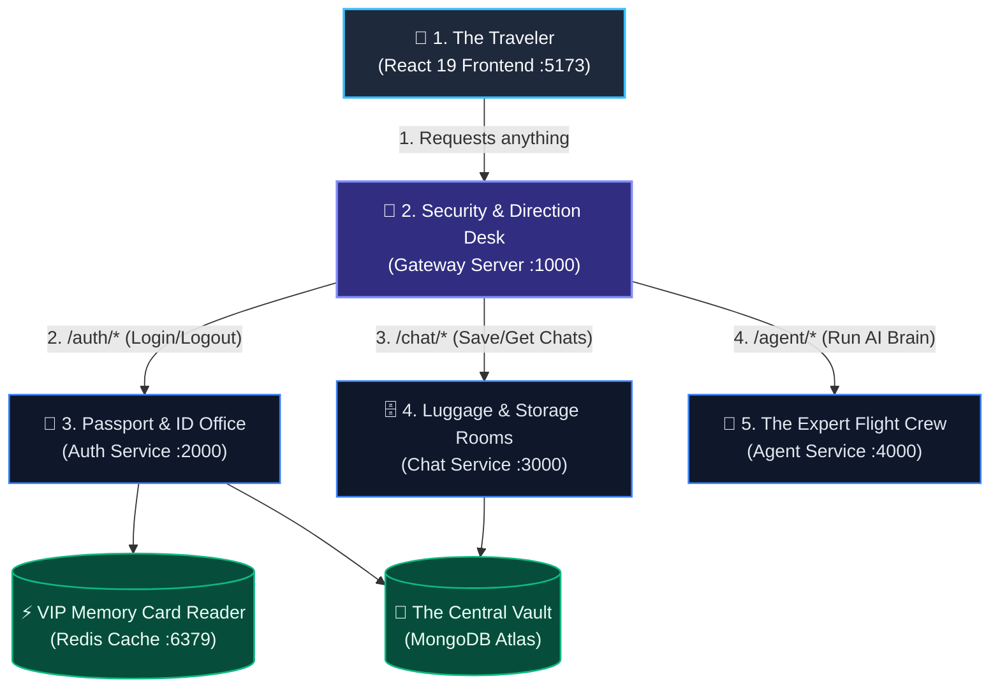
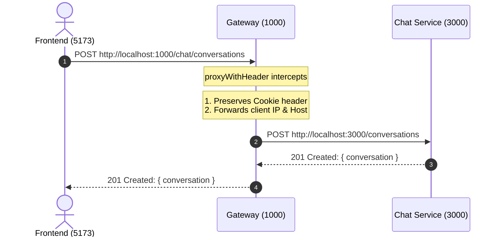
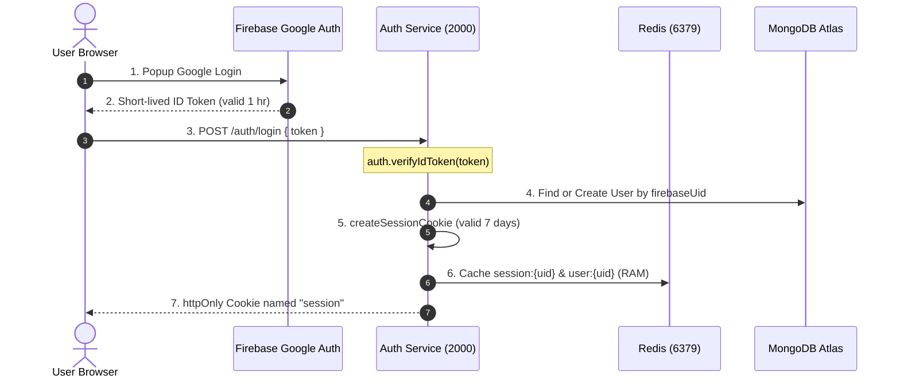
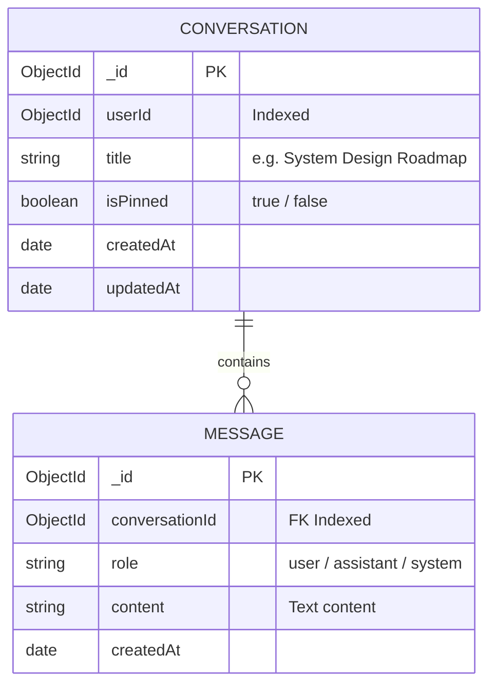
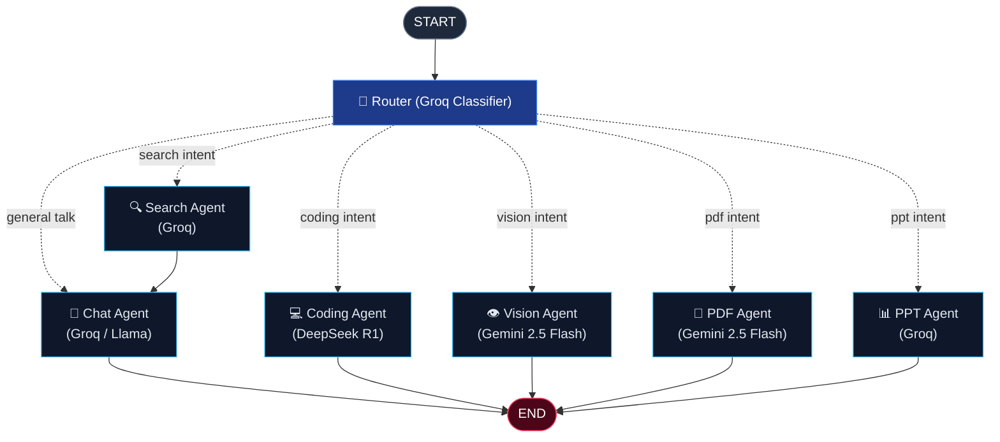

# 🎓 Backend Masterclass Notes — Agentic AI Under The Hood

> **Teacher's Note**: Imagine building a restaurant with 4 specialized staff members rather than a single overwhelmed cook. This document breaks down every service, every package, and every line of flow in plain, intuitive English with visual diagrams.

---

## 🗺️ Chapter 1: The Big Picture (The Airport Analogy)

Imagine your entire application as an **International Airport**:



1. **Frontend (Traveler)**: Only speaks to **one** person: the Entrance Door (Gateway on Port 1000). The traveler never needs to know where the kitchen or luggage room is located.
2. **Gateway (Entrance Desk)**: Directs the traveler. If they say *"I want to login"*, it forwards them to Passport Control. If they say *"Show my chats"*, it forwards them to the Locker Room.
3. **Auth Service (Passport Control)**: Verifies identity with Firebase, writes a passport stamp (Session Cookie), and remembers it in Redis.
4. **Chat Service (Locker Room)**: Stores conversations and chat messages in MongoDB.
5. **Agent Service (Expert Crew)**: The AI brain. Routes questions to specialized agents (Coder, Searcher, Reader, Slide Creator).

---

## 🚪 Chapter 2: The Gateway Service (Port 1000)

### Why Do We Even Need a Gateway?
**Problem without a Gateway**: If you had 3 backend services (Auth on 2000, Chat on 3000, Agent on 4000), your frontend would have to keep track of 3 different URLs, manage 3 different CORS permissions, and send cookies across multiple domains.
**Solution with a Gateway**: The frontend only ever talks to **`http://localhost:1000`**. The Gateway acts as a **Single Front Door** (Reverse Proxy).



### Key Packages in Gateway:
- **`express-http-proxy`**: The magic package that takes an incoming request stream and pipes it directly to another server without consuming memory or converting it to JSON first.
- **`cors`**: Tells the browser: *"Yes, requests from `http://localhost:5173` are allowed to talk to me and send cookies (`credentials: true`)."*

### Under The Hood: `proxyWithHeader.js`
```javascript
const proxyWithHeader = (serviceUrl) => {
  return proxy(serviceUrl, {
    proxyReqOptDecorator: (proxyReqOpts, srcReq) => {
      // Passes the traveler's security wristband (cookie) along to Chat/Agent
      if (srcReq.headers.cookie) {
        proxyReqOpts.headers["cookie"] = srcReq.headers.cookie;
      }
      return proxyReqOpts;
    },
  });
};
```
*Why this syntax?* `proxyReqOptDecorator` is an Express HTTP Proxy hook. Before the proxy packet leaves Port 1000 to travel to Port 3000, this function copies the browser's `cookie` so the receiving service knows who sent it.

---

## 🔐 Chapter 3: The Auth Service (Port 2000)

### The Life of a Login:


### Why Do We Use Redis? (The Memory Trick)
- **MongoDB** saves data to a **hard drive / SSD** (Disk). Reading from disk takes **5ms – 25ms**.
- **Redis** saves data directly in **computer memory** (RAM). Reading from RAM takes **0.5ms – 1ms** (20x faster!).
- Every time a user clicks around the app, we need to verify their login. Instead of bombarding MongoDB thousands of times a minute, we check Redis in micro-seconds!

### Why `httpOnly: true` on Cookies?
If a malicious hacker injects an evil JavaScript script (XSS) onto your website, `document.cookie` in JavaScript **cannot see or steal** an `httpOnly` cookie. The browser protects it at the operating-system level.

---

## 💬 Chapter 4: The Chat Service (Port 3000)

### Why Did We Remove Firebase from Chat?
In bad code design, beginners install `firebase-admin` in *every single service*.
- **The Problem**: If you change your Firebase key, you have to update 4 servers. It wastes memory and creates messy code.
- **The Clean Solution**: Only the **Auth Service** verifies Firebase. The **Chat Service** just trusts the Gateway and reads `x-user-id` or the session.

### The 2 Mongoose Models:


### Why Do We Add Indexes? (`schema.index(...)`)
Imagine a book with **1,000,000 pages**:
- **Without an Index (COLLSCAN)**: To find messages for conversation `123`, MongoDB has to read all 1,000,000 pages one by one.
- **With a Compound Index (`{ conversationId: 1, createdAt: 1 }`)**: MongoDB looks at the index table at the back of the book, jumps directly to page 412, and reads only your messages in chronological order in **1 millisecond**.

---

## 🤖 Chapter 5: The Agent Service (Port 4000)

### What is LangGraph?
LangGraph treats AI not like a single prompt, but like an **assembly line**:



### 1. The State Clipboard (`state.js`)
LangGraph passes an object called `AgentState` between every node like a shared clipboard:
```javascript
export const AgentState = Annotation.Root({
  prompt: Annotation(),      // What the user asked
  agent: Annotation(),       // Who the router picked
  aiResponse: Annotation(),  // The final answer
});
```

### 2. Why Different LLM Models? (`getModel`)
Different AI models have different superpowers:
- **Groq (Llama 3.3 / GPT-OSS)**: **Speed**. Generates answers at 500 tokens/sec. Best for quick router decisions and general talk.
- **DeepSeek (R1)**: **Logic & Math**. Spends internal "thinking tokens" on coding, algorithms, and deep reasoning.
- **Google Gemini (2.5 Flash)**: **Vision & Huge Files**. Can see images and read 1,000-page PDF books (up to 1,000,000 tokens).

---

## 💡 Chapter 6: The 3 Core Backend Rules (KISS, DRY, Patterns)

### 1. What is `AsyncHandler`?
Normally in Express, if an asynchronous `await` fails, Node.js throws an unhandled promise rejection and can freeze.
Instead of typing `try { ... } catch (err) { next(err) }` in **every single controller**, we wrap it:
```javascript
// Magic: Catches any error and forwards it to errorHandler automatically!
export const myController = AsyncHandler(async (req, res) => {
  const data = await Model.find();
  return sendResponse(res, 200, true, "Success", data);
});
```

### 2. What is `sendResponse`?
Ensures your frontend always receives JSON with the exact same shape:
```json
{
  "success": true,
  "statusCode": 200,
  "message": "Conversations fetched successfully",
  "data": { ... }
}
```
Your frontend never has to guess if data is inside `.result`, `.items`, or `.payload`!

### 3. What is `router.use(protect)`?
Instead of adding `protect` to 10 routes individually:
```javascript
// ❌ Repetitive:
router.post("/a", protect, funcA);
router.post("/b", protect, funcB);

// ✅ Clean & DRY:
router.use(protect); // Every route below is automatically protected!
router.post("/a", funcA);
router.post("/b", funcB);
```
Inside your controllers, `req.user.id` is guaranteed to exist.

