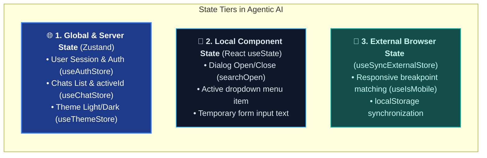
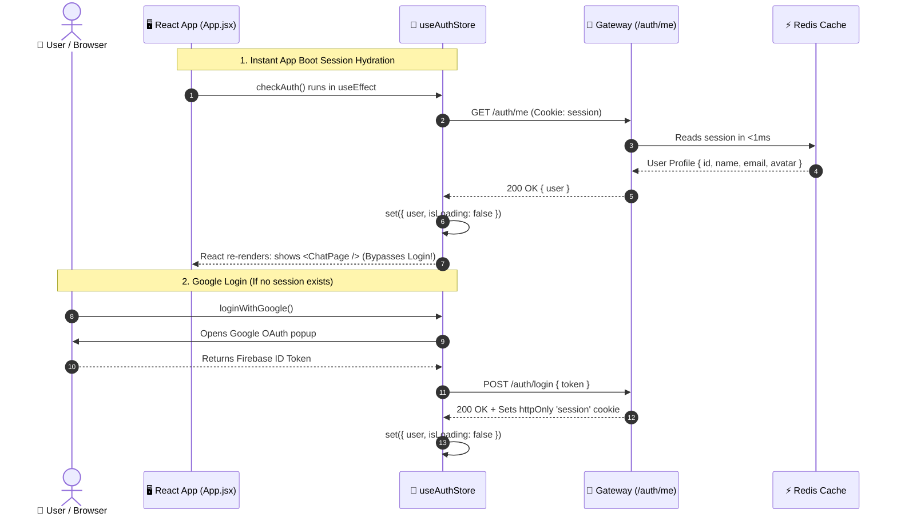
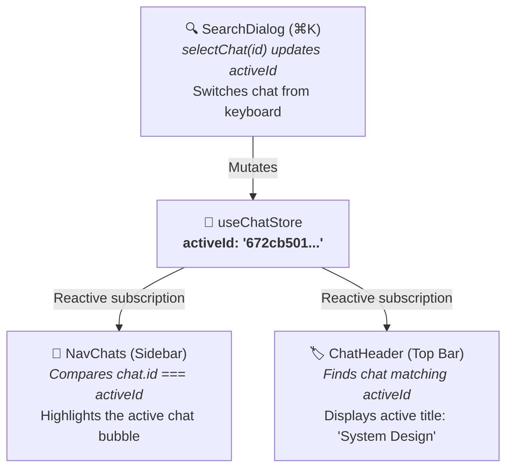
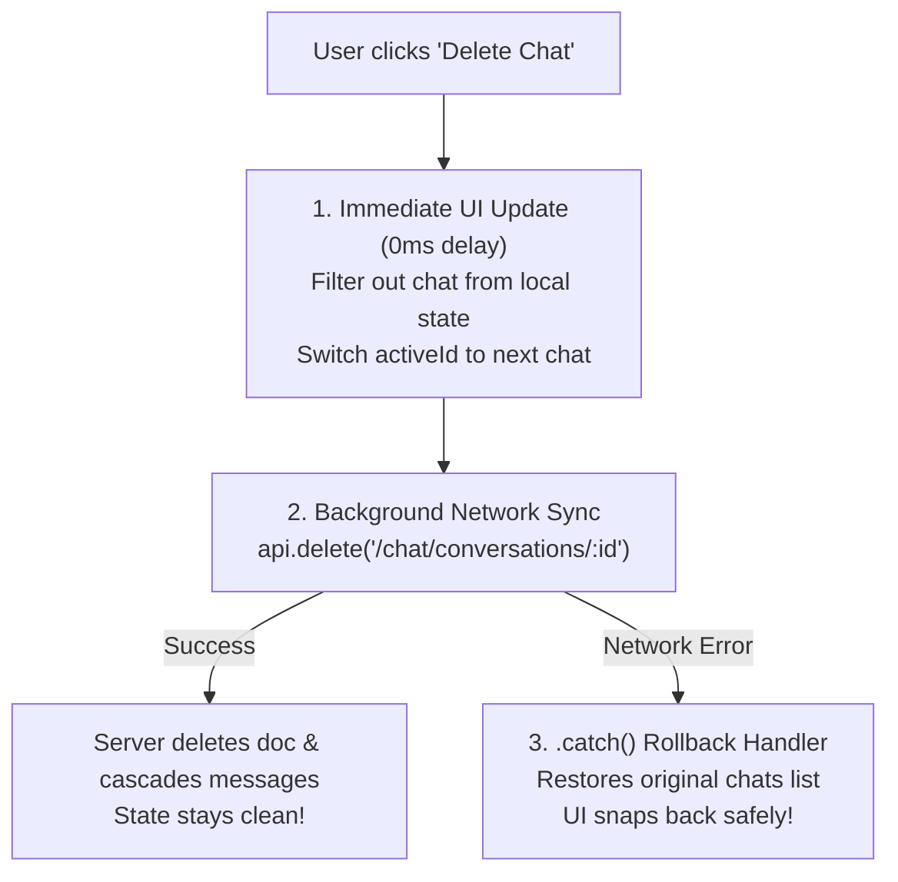

# 🧠 Frontend State Management Guide — Agentic AI

> **Purpose**: A comprehensive architectural guide and learning note on how state is structured, synchronized, and managed across the React 19 frontend of **Agentic AI**.

---

## 1. The 3 Types of State in Agentic AI

Rather than dumping everything into a massive global state or using heavy Redux boilerplate, our frontend splits state into 3 distinct, purposeful tiers:



---

## 2. Store 1: `useAuthStore` — Identity & Edge Session Hydration

### State Structure
```javascript
{
  user: null,         // Sanitized user object { id, name, email, avatar, firebaseUid }
  isLoading: true,    // True until initial /auth/me check completes
  error: null,        // Human-readable error message or null
}
```

### Visual Auth & Hydration Flow



### Clean Code Pattern: Native `finally` for Loading
Instead of repeating `set({ isLoading: false })` inside both `try` and `catch`, we use native `finally`:

```javascript
checkAuth: async () => {
  try {
    const { data } = await api.get("/auth/me");
    set({ user: data.user });
  } catch {
    set({ user: null });
  } finally {
    set({ isLoading: false }); // Runs 100% of the time, zero repetition!
  }
}
```

---

## 3. Store 2: `useChatStore` — Slices Pattern & Separation of Concerns

To keep the codebase maintainable and modular as features scale, `useChatStore` is organized using the **Zustand Slices Pattern**:
- **`slices/conversationSlice.js`**: Owns conversation metadata, list fetching, active chat selection (`activeId`), inline renaming, pinning, and deletion.
- **`slices/messageSlice.js`**: Owns message thread state, optimistic appending, MongoDB message persistence, and the LangGraph AI agent pipeline call (`:4000`).
- **`useChatStore.js`**: Combines both slices into a single unified store hook with 0 breaking changes to component consumers.

### State Structure
```javascript
{
  chats: [],              // Array of conversations [{ id, title, isPinned, updatedAt }]
  activeId: null,         // ID string of the currently opened conversation
  messages: [],           // Array of messages for active conversation [{ id, role, content, createdAt }]
  isLoading: false,       // True while fetching initial chat list
  isMessagesLoading: false,// True while fetching messages for active conversation
  isSending: false,       // True while submitting a message to backend
  searchOpen: false,      // Boolean controlling Command Palette (⌘K)
}
```

### The `activeId` Pointer: How Selection Works Across the UI

The `activeId` is the single source of truth for **which conversation is open**. Multiple components listen to it simultaneously via atomic selectors:



### 1. `selectChat(id)` Action
```javascript
selectChat: (id) => {
  set({ activeId: id }, false, "chat/selectChat");
  if (id) get().fetchMessages(id);
}
```
When a user clicks any chat in the sidebar or searches in `⌘K`:
1. `selectChat(id)` sets `activeId`.
2. `NavChats` re-renders and highlights the clicked item with `isActive: true`.
3. `ChatHeader` re-renders and updates the top title.
4. Triggers `fetchMessages(id)` to load the active conversation's thread.

### 2. `sendMessage(content)` Action
```javascript
sendMessage: async (content) => {
  // 1. Optimistic append user message to UI (0ms latency)
  // 2. Intelligent Auto-Naming for "New chat"
  // 3. Persist user message to MongoDB (POST /chat/conversations/:id/messages)
  // 4. Request AI Agent pipeline from Agent Service (POST /agent)
  // 5. Append & persist AI response to MongoDB (role: "assistant")
}
```
If no conversation is open, `sendMessage` calls `newChat()` first to automatically spawn a conversation before sending, providing a seamless ChatGPT-like user flow.

---

## 4. Zero-Latency Optimistic UI Updates & `.catch()` Rollbacks

Modern applications like ChatGPT, Slack, or Linear never make the user wait for a network round-trip when pinning, renaming, or deleting an item. We use **Optimistic Updates**.

### Pattern: Immediate UI Reaction with Background Network Rollback



### The Code Implementation in `useChatStore.js`:

```javascript
// Delete conversation (Optimistic update with .catch() rollback)
deleteChat: (id) => {
  if (!id) return;
  const prevChats = get().chats;
  const remaining = prevChats.filter((c) => (c.id || c._id) !== id);
  const nextActiveId =
    get().activeId === id
      ? remaining[0]?.id || remaining[0]?._id || null
      : get().activeId;

  // Step 1: Update UI immediately (0ms lag!)
  set({
    chats: remaining,
    activeId: nextActiveId,
  }, false, "chat/deleteChat");

  // Only sync to server if it is a persisted MongoDB record
  const isMongoId = /^[0-9a-fA-F]{24}$/.test(id);
  if (!isMongoId) return;

  // Step 2: Sync with server; roll back ONLY if request fails with a true server error
  api.delete(`/chat/conversations/${id}`).catch((err) => {
    if (err?.response?.status === 404) return; // Already gone on server
    set({ chats: prevChats }, false, "chat/deleteChat/rollback");
  });
},

// Unified optimistic updater (DRY: centralizes map, patch & rollback for any property)
updateChat: (id, updates, actionName = "chat/updateChat") => {
  const prevChats = get().chats;

  // Step 1: Immediate UI update (0ms lag!)
  set(
    { chats: prevChats.map((c) => (c.id === id ? { ...c, ...updates } : c)) },
    false,
    actionName
  );

  // Step 2: Background sync; rolls back ONLY if request fails
  api.patch(`/chat/conversations/${id}`, updates).catch(() => {
    set({ chats: prevChats }, false, `${actionName}/rollback`);
  });
},

// Rename conversation (3 lines!)
renameChat: (id, newTitle) => {
  const title = newTitle?.trim();
  if (title) get().updateChat(id, { title }, "chat/renameChat");
},

// Toggle pin status (3 lines!)
pinChat: (id) => {
  const chat = get().chats.find((c) => c.id === id);
  if (chat) get().updateChat(id, { isPinned: !chat.isPinned }, "chat/pinChat");
},
}
```

---

## 5. React 19 State Best Practices: Atomic Selectors

### The Golden Rule: Never Destructure the Entire Store!

```jsx
// ❌ ANTI-PATTERN: Re-renders this component on ANY change to ANY state property
const { chats, activeId, isLoading, newChat, deleteChat } = useChatStore();

// ✅ SENIOR PATTERN: Atomic Selectors (Only re-renders when THAT exact property changes!)
const chats = useChatStore((s) => s.chats);
const activeId = useChatStore((s) => s.activeId);
const newChat = useChatStore((s) => s.newChat);
```

### Why Atomic Selectors Matter
If `SearchDialog` only cares about `searchOpen`, it shouldn't re-render when a user types a new chat message. Atomic selectors give fine-grained reactivity, making the app blazing fast without manual `useMemo` or `useCallback`.

---

## 6. External Browser State: `useSyncExternalStore` (`useIsMobile`)

In React 19, reading browser dimensions inside `useEffect` with synchronous `setState` causes hydration mismatches and cascading render warnings.

We use **`useSyncExternalStore`** in [`frontend/hooks/use-mobile.js`](./frontend/hooks/use-mobile.js):

```javascript
import { useSyncExternalStore } from "react";

const MOBILE_BREAKPOINT = 768;

function subscribe(callback) {
  const mql = window.matchMedia(`(max-width: ${MOBILE_BREAKPOINT - 1}px)`);
  mql.addEventListener("change", callback);
  return () => mql.removeEventListener("change", callback);
}

export function useIsMobile() {
  return useSyncExternalStore(
    subscribe,
    () => window.innerWidth < MOBILE_BREAKPOINT,
    () => false
  );
}
```
* **Zero useEffect boilerplate**.
* **Zero cascading renders**.
* **Zero hydration mismatch**.

---

## 7. Summary: When to Use Which State Pattern

| Need | Right Tool | Why? |
| :--- | :--- | :--- |
| **Auth Session, User Profile** | Zustand (`useAuthStore`) | Accessible anywhere (components, axios interceptors, routers). |
| **Conversations List & Active Selection** | Zustand (`useChatStore`) | Synchronizes sidebar, header, and command palette simultaneously. |
| **Theme (Dark / Light)** | Zustand (`useThemeStore`) | Immediate `<html>` class toggle and localStorage persistence. |
| **Dropdown Menus & Dialog Visibility** | `useState` or Base UI primitives | Local to that specific button or modal; no other component needs it. |
| **Window Resizing / Media Queries** | `useSyncExternalStore` | Official React 19 standard for external browser subscriptions. |
| **Optimistic Network Actions** | `.catch(() => rollback)` | 0ms UI reaction with graceful rollback if offline. |

