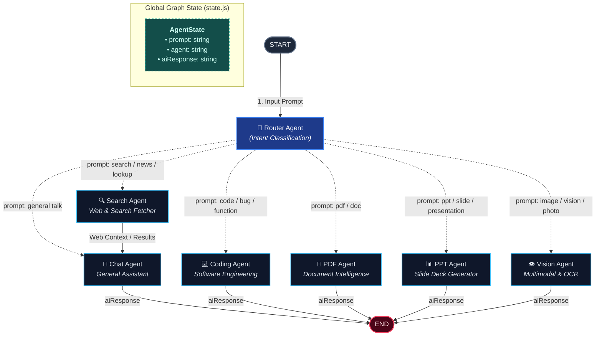

# 🤖 Agent Service — LangGraph Multi-Agent Architecture

> **Port**: `4000`  
> **Role**: AI Multi-Agent Orchestration, Intent Classification & Routing via LangGraph  
> **Analogy**: Think of the Agent Service like the **Hospital Triage & Specialist Clinic**. When a patient arrives with a symptom (Prompt), the Triage Nurse (Router) diagnoses the need and assigns the exact specialist doctor (Coder, Searcher, PDF Analyst, Slide Designer, Vision Specialist, or General Chat). The specialist treats the patient and delivers the final response.

---

## 1. Visual Architecture Graph



---

## 2. Graph State Lifecycle (`graph/state.js`)

At every step of the graph, nodes read from and update a shared, immutable-friendly state schema:

```javascript
export const AgentState = Annotation.Root({
  prompt: Annotation(),      // The user's input query or message
  agent: Annotation(),       // Active specialist assigned by the router
  aiResponse: Annotation(),  // Generated output from the executed agent
});
```

| Lifecycle Step | `prompt` | `agent` | `aiResponse` | Node Responsible |
| :--- | :--- | :--- | :--- | :--- |
| **1. Ingress** | `"Fix this Javascript bug"` | `undefined` | `undefined` | `START` |
| **2. Routing** | `"Fix this Javascript bug"` | `"coding"` | `undefined` | `router` |
| **3. Execution** | `"Fix this Javascript bug"` | `"coding"` | `"Here is the fixed code..."` | `codingAgent` |
| **4. Egress** | `"Fix this Javascript bug"` | `"coding"` | `"Here is the fixed code..."` | `END` |

---

## 3. Nodes & Specialized Agents Breakdown

| Node | File Location | Responsibility | Trigger Keywords |
| :--- | :--- | :--- | :--- |
| **Router** | [`graph/router.js`](./graph/router.js) | Analyzes input query and decides which agent should handle it | Always runs first after `START` |
| **Chat Agent** | [`agents/chat.agent.js`](./agents/chat.agent.js) | Conversational assistant, creative writing, answering general questions | Default fallback or general conversation |
| **Search Agent** | [`agents/search.agent.js`](./agents/search.agent.js) | Gathers real-time web results, weather, news, or fact-checking | `search`, `latest`, `find`, `lookup` |
| **Coding Agent** | [`agents/coding.agent.js`](./agents/coding.agent.js) | Writes code, debugs errors, refactors snippets, explains syntax | `code`, `function`, `bug`, `refactor` |
| **PDF Agent** | [`agents/pdf.agent.js`](./agents/pdf.agent.js) | Parses and analyzes PDF files, summarization, document Q&A | `pdf`, `doc`, `document` |
| **PPT Agent** | [`agents/ppt.agent.js`](./agents/ppt.agent.js) | Outlines slide decks, generates presentations and markdown slides | `ppt`, `presentation`, `slide`, `pitch` |
| **Vision Agent** | [`agents/vision.agent.js`](./agents/vision.agent.js) | Processes images, performs OCR, detects objects, multimodal prompts | `image`, `vision`, `photo`, `screenshot` |

---

## 4. Execution Flow in Code (`graph/graph.js`)

```javascript
import { StateGraph, START, END } from "@langchain/langgraph";
import { AgentState } from "./state.js";
import { router } from "./router.js";
// Agents
import { chatAgent } from "../agents/chat.agent.js";
import { searchAgent } from "../agents/search.agent.js";
import { codingAgent } from "../agents/coding.agent.js";
import { pdfAgent } from "../agents/pdf.agent.js";
import { pptAgent } from "../agents/ppt.agent.js";
import { visionAgent } from "../agents/vision.agent.js";

const agents = {
  chat: chatAgent,
  search: searchAgent,
  coding: codingAgent,
  pdf: pdfAgent,
  ppt: pptAgent,
  vision: visionAgent,
};

const workflow = new StateGraph(AgentState);

// 1. Entry point to router
workflow.addNode("router", router);
workflow.addEdge(START, "router");

// 2. Register all agent nodes & connect to END
Object.entries(agents).forEach(([name, agentFn]) => {
  workflow.addNode(name, agentFn);
  workflow.addEdge(name, END);
});

// 3. Conditional routing from router
workflow.addConditionalEdges("router", (state) => {
  return agents[state.agent] ? state.agent : "chat";
});

export const agentGraph = workflow.compile();
```

---

## 5. Quick Test Invocation

```javascript
import { agentGraph } from "./graph/graph.js";

const response = await agentGraph.invoke({
  prompt: "Can you review this React useState function bug?",
});

console.log(response);
// Output:
// {
//   prompt: 'Can you review this React useState function bug?',
//   agent: 'coding',
//   aiResponse: 'Coding response'
// }
```

