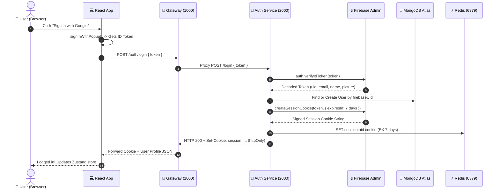

# 🔐 Auth Service — Identity, Sessions & Security

> **Port**: `2000`  
> **Role**: Authentication, Firebase Admin Verification, MongoDB User Persistence, Redis Session Caching  
> **Analogy**: Think of the Auth Service like the **Passport & Immigration Office**. When a visitor shows up with their ID (Firebase Google Token), the officer checks if it's authentic, creates an official visitor profile in the master ledger (MongoDB), issues a stamped, tamper-proof wristband (httpOnly `session` cookie), and records their active visit in the quick-lookup security board (Redis).

---

## 1. Visual Authentication Flow



---

## 2. Directory & File Breakdown

```
backend/services/auth/
├── configs/
│   ├── db.js                 # MongoDB connection using Mongoose
│   └── firebase.js           # Initializes Firebase Admin SDK with serviceAccountKey.json
├── controller/
│   └── auth.controller.js    # Business logic for login, logout, and getMe
├── middlewares/
│   ├── auth.middleware.js    # Reads session cookie, validates via Firebase & Redis
│   ├── errorHandler.js       # Formats errors into standardized JSON responses
│   └── notFound.js           # 404 handler
├── model/
│   └── user.model.js         # Mongoose User schema (firebaseUid, email, name, picture)
├── routes/
│   └── auth.route.js         # Route declarations (/login, /logout, /me)
├── utils/
│   ├── ApiError.js           # Custom Error class with statusCode
│   ├── AsyncHandler.js       # Wrapper to catch async promise rejections
│   └── sendResponse.js       # Standardized API response formatter
├── .env                      # Service Port, Mongo URI, Session Expiry
├── index.js                  # Express app setup and middleware mounting
└── package.json              # Auth dependencies
```

---

## 3. Step-by-Step Execution Walkthrough

### 1. `POST /login` (Creating a Secure Session)
1. **Frontend** initiates Google sign-in and gets a short-lived Firebase ID token (valid for ~1 hour).
2. The ID token is sent to `POST /auth/login`.
3. **`auth.verifyIdToken(token)`** validates the cryptographic signature with Google's servers.
4. **MongoDB Lookup**: Checks if a user with `firebaseUid` exists. If not, it automatically registers a new user with their Google profile name, email, and avatar picture.
5. **Session Cookie Generation**: Calls `auth.createSessionCookie(token, { expiresIn: 7 days })`.
6. **Redis Cache**: Saves the cookie in Redis with `redis.set(key, sessionCookie, "EX", 7 days)`.
7. **Response**: Sets an `httpOnly`, `secure`, `sameSite: "lax"` cookie named `session` and returns the sanitized user JSON.

### 2. `GET /me` (Session Hydration)
When the user refreshes the page:
1. React calls `GET /auth/me` with `withCredentials: true`.
2. The browser automatically includes the `session` cookie.
3. The server reads `req.cookies.session`.
4. It calls **`auth.verifySessionCookie(sessionCookie, true)`** with `checkRevoked = true`.
   - If the user's password was changed or tokens revoked, this immediately fails.
5. If valid, the user record is fetched from MongoDB and returned to React.

### 3. `POST /logout` (Full Invalidation)
Security means not just deleting the cookie from the browser, but **destroying it on the server**:
1. Clear the `session` cookie via `res.clearCookie("session")`.
2. Delete the Redis key `session:${uid}`.
3. Call **`auth.revokeRefreshTokens(uid)`** in Firebase Admin so stolen cookies cannot be reused.

---

## 4. Why Use `httpOnly` Cookies Instead of LocalStorage?

| Storage Method | Safe from XSS (Hacker Scripts)? | Automatically Sent with Requests? | Best Practice? |
| :--- | :---: | :---: | :---: |
| **LocalStorage** | ❌ NO (Any injected script can steal your token) | ❌ NO (Must manually attach `Bearer ...`) | ⚠️ Not recommended for sensitive tokens |
| **`httpOnly` Cookie** | ✅ **YES** (JavaScript CANNOT read this cookie) | ✅ **YES** (Browser sends it automatically) | 🏆 **Gold Standard** |

---

## 5. Packages Used & Why

| Package | Why we use it |
| :--- | :--- |
| `firebase-admin` | Official server SDK to securely verify ID tokens, mint session cookies, and revoke refresh tokens. |
| `mongoose` | Object Data Modeling (ODM) for MongoDB to define user schemas and manage validation. |
| `cookie-parser` | Express middleware to read `req.cookies.session` seamlessly. |
| `ioredis` | Ultra-fast Redis client imported from `backend/shared/redis/redis.js` to cache session states. |

---

## 6. How to Run Locally

```bash
cd backend/services/auth
npm run dev
# Server will start on http://localhost:2000
```

