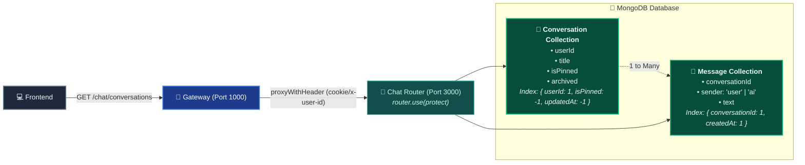

# 💬 Chat Service — Conversation & Message Persistence

> **Port**: `3000`  
> **Role**: Managing Conversations, Chat History, Pinned Chats, and Message Storage  
> **Analogy**: Think of the Chat Service like the **Digital Filing Cabinet & Librarian**. Every conversation is a labeled folder (with a title and pin status), and each message is a timestamped page inside that folder. The librarian keeps them organized in chronological order and indexed so they can be retrieved in milliseconds.

---

## 1. Visual Flow & Database Architecture



---

## 2. Directory & File Breakdown

```
backend/services/chat/
├── configs/
│   └── db.js                 # MongoDB connection using Mongoose
├── controller/
│   └── chat.controller.js    # 6 Focused controller functions: create, list, update, delete, save, list messages
├── middlewares/
│   ├── auth.middleware.js    # Lightweight 10-line protect middleware (DRY)
│   ├── errorHandler.js       # Global error response handler
│   ├── notFound.js           # 404 handler
│   └── validate.middleware.js # Reusable Zod validation middleware (attaches req.validated)
├── model/
│   ├── conversation.model.js # Conversation schema with compound index
│   └── message.model.js      # Message schema with compound index
├── routes/
│   └── chat.route.js         # REST endpoints protected by router.use(protect) and validate()
├── schemas/
│   └── chat.schema.js        # Zod validation schemas with type auto-trimming & role mapping
├── utils/
│   ├── ApiError.js           # Custom Error with HTTP status codes
│   ├── AsyncHandler.js       # Catches async promise rejections
│   └── sendResponse.js       # Consistent JSON response formatter
├── .env                      # Service Port & Mongo URI
├── index.js                  # Express app entry point
└── package.json              # Chat dependencies (including Zod)
```

---

## 3. Database Models & The Power of Compound Indexes

### A. Conversation Model (`model/conversation.model.js`)
```javascript
const conversationSchema = new mongoose.Schema(
  {
    title: { type: String, required: true, trim: true, default: "New Chat" },
    userId: { type: String, required: true },
    isPinned: { type: Boolean, default: false },
    archived: { type: Boolean, default: false },
  },
  { timestamps: true }
);

// 🚀 Compound Index for ultra-fast sorting
conversationSchema.index({ userId: 1, isPinned: -1, updatedAt: -1 });
```

> [!TIP]
> **Why this Compound Index?**  
> When the sidebar loads, we want to fetch:
> 1. Only **my** conversations (`userId: 1`).
> 2. Pinned chats **at the top** (`isPinned: -1`).
> 3. Most recently updated chats **first** (`updatedAt: -1`).  
> This compound index lets MongoDB satisfy the search and sort **in a single query** without scanning other users' data!

### B. Message Model (`model/message.model.js`)
```javascript
const messageSchema = new mongoose.Schema(
  {
    conversationId: { type: mongoose.Schema.Types.ObjectId, ref: "Conversation", required: true },
    sender: { type: String, enum: ["user", "ai"], required: true },
    text: { type: String, required: true },
  },
  { timestamps: true }
);

// 🚀 Compound Index for chronological message loading
messageSchema.index({ conversationId: 1, createdAt: 1 });
```

---

## 4. DRY Clean Architecture: `router.use(protect)`

Instead of writing `if (!userId) throw new ApiError(...)` inside every single controller function, we enforce protection at the router level in `routes/chat.route.js`:

```javascript
import express from "express";
import {
  createConversation,
  getConversations,
  updateConversation,
  deleteConversation,
  saveMessages,
  getMessages,
} from "../controller/chat.controller.js";
import { protect } from "../middlewares/auth.middleware.js";
import { validate } from "../middlewares/validate.middleware.js";
import {
  createConversationSchema,
  updateConversationSchema,
  saveMessagesSchema,
} from "../schemas/chat.schema.js";

const router = express.Router();

// 🛡️ Protect ALL chat endpoints below
router.use(protect);

// Conversation management
router.post("/conversations", validate(createConversationSchema), createConversation);
router.get("/conversations", getConversations);
router.patch("/conversations/:id", validate(updateConversationSchema), updateConversation);
router.delete("/conversations/:id", deleteConversation);

// Message management
router.post("/conversations/:id/messages", validate(saveMessagesSchema), saveMessages);
router.get("/conversations/:id/messages", getMessages);

export default router;
```

---

## 5. Endpoints Reference

| Method | Endpoint | Description |
| :--- | :--- | :--- |
| `POST` | `/chat/conversations` | Creates a new chat session (`{ title }`). |
| `GET` | `/chat/conversations` | Retrieves all conversations for the user, sorted by pinned first and updated time. |
| `PATCH` | `/chat/conversations/:id` | Updates chat properties (renaming `title` or toggling `isPinned`). |
| `DELETE` | `/chat/conversations/:id` | Deletes conversation and cascades deletion of all its messages. |
| `POST` | `/chat/conversations/:id/messages` | Saves a message or batch of messages (`{ role, content }` or `{ messages: [...] }`). |
| `GET` | `/chat/conversations/:id/messages` | Loads chronological message history for a conversation. |

---

## 6. How to Run Locally

```bash
cd backend/services/chat
npm run dev
# Server will start on http://localhost:3000
```

