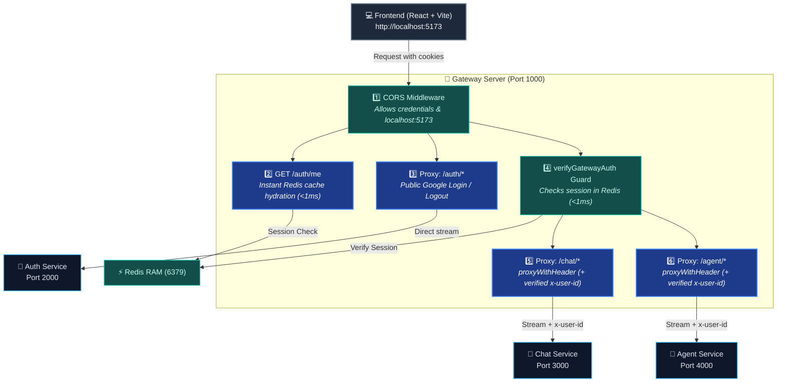

# 🚪 Gateway Service — The Front Door of Agentic AI

> **Port**: `1000`  
> **Role**: API Gateway, Reverse Proxy, CORS Manager & Session Forwarder 
> **Analogy**: Think of the Gateway like the **Airport Security & Gate Boarding Desk**. The traveler (React Frontend) only enters through **one single gate** (Port 1000). The security agent checks permissions (CORS), preserves their ticket/badge (Cookies & User ID), and directs them to the correct terminal flight (Auth, Chat, or Agent service).

---

## 1. Visual Architecture Flow



---

## 2. Why Do We Need a Gateway?

Without a gateway:
- The frontend would have to remember 3+ ports (`localhost:2000`, `localhost:3000`, `localhost:4000`).
- If you change a service's port or domain, you'd have to rewrite all frontend API calls.
- Browser cookies are domain-specific. Calling multiple ports creates difficult cross-site cookie headaches.

**With the Gateway**:
- The frontend sends **100% of its requests** to `http://localhost:1000`.
- The Gateway automatically forwards:
  - `POST /auth/login` ➡️ `http://localhost:2000/login`
  - `GET /chat/conversations` ➡️ `http://localhost:3000/conversations`
  - `POST /agent/chat` ➡️ `http://localhost:4000/chat`

---

## 3. Directory & File Breakdown

```
backend/services/gateway/
├── middlewares/
│   ├── auth.middleware.js    # Edge Auth Guard: verifies Redis session in <1ms & injects req.user
│   ├── errorHandler.js       # Catches unhandled errors & returns clean JSON
│   └── notFound.js           # Catches 404 routes not registered
├── utils/
│   ├── ApiError.js           # Standardized error definitions
│   ├── AsyncHandler.js       # Promise rejection wrapper
│   └── proxyWithHeader.js    # Decorator that attaches cookies & user ID to proxied requests
├── .env                      # Ports & Downstream Service URLs
├── index.js                  # Main entry point & proxy configuration
└── package.json              # Gateway dependencies
```

---

## 4. Key Code Explained (Under the Hood)

### A. The Proxy Decorator (`utils/proxyWithHeader.js`)

When a request arrives at the Gateway, it contains the browser's `cookie` (with the user's `session`).  
By default, some proxy libraries strip or alter headers. Our `proxyWithHeader` ensures nothing is lost:

```javascript
import proxy from "express-http-proxy";

const proxyWithHeader = (serviceUrl) => {
  return proxy(serviceUrl, {
    proxyReqOptDecorator: (proxyReqOpts, srcReq) => {
      // 1. Forward the session cookie so downstream services know WHO is calling
      if (srcReq.headers.cookie) {
        proxyReqOpts.headers["cookie"] = srcReq.headers.cookie;
      }

      // 2. Safely forward x-user-id if present
      if (srcReq.user?.id) {
        proxyReqOpts.headers["x-user-id"] = srcReq.user.id;
      }

      return proxyReqOpts;
    },
  });
};
```

### B. Middleware Order in `index.js` (Crucial Golden Rule!)

Look at lines 13–28 of `index.js`:

```javascript
// 1. CORS FIRST: Always process preflight OPTIONS requests before anything else!
app.use(cors({ origin: ["http://localhost:5173"], credentials: true }));

// 2. PROXIES SECOND: Forward raw streams directly to downstream microservices!
app.use("/auth", proxy(process.env.AUTH_SERVICE));
app.use("/chat", verifyGatewayAuth, proxyWithHeader(process.env.CHAT_SERVICE));
app.use("/agent", verifyGatewayAuth, proxyWithHeader(process.env.AGENT_SERVICE));

// 3. BODY PARSER THIRD: Native JSON parser
app.use(express.json());
```

> [!WARNING]
> **Why is `express.json()` placed AFTER the proxies?**  
> In Node.js, HTTP request bodies are **streams of data chunks**. If `express.json()` runs first, it reads and finishes the stream in memory. When `express-http-proxy` tries to pipe the stream to `chat` or `agent`, the stream is already empty, causing downstream services to hang forever or receive an empty body!

---

## 5. Packages Used & Why

| Package | Why we use it |
| :--- | :--- |
| `express` (v5) | Fast, lightweight HTTP server framework. |
| `express-http-proxy` | Streams incoming client requests directly to target microservices without buffering entire payloads in RAM. |
| `cors` | Allows our React frontend on `localhost:5173` to safely communicate with `localhost:1000` with `credentials: true`. |
| `dotenv` | Loads environment variables (`PORT`, `AUTH_SERVICE`, `CHAT_SERVICE`, `AGENT_SERVICE`). |

---

## 6. How to Run Locally

```bash
cd backend/services/gateway
npm run dev
# Server will start on http://localhost:1000
```

