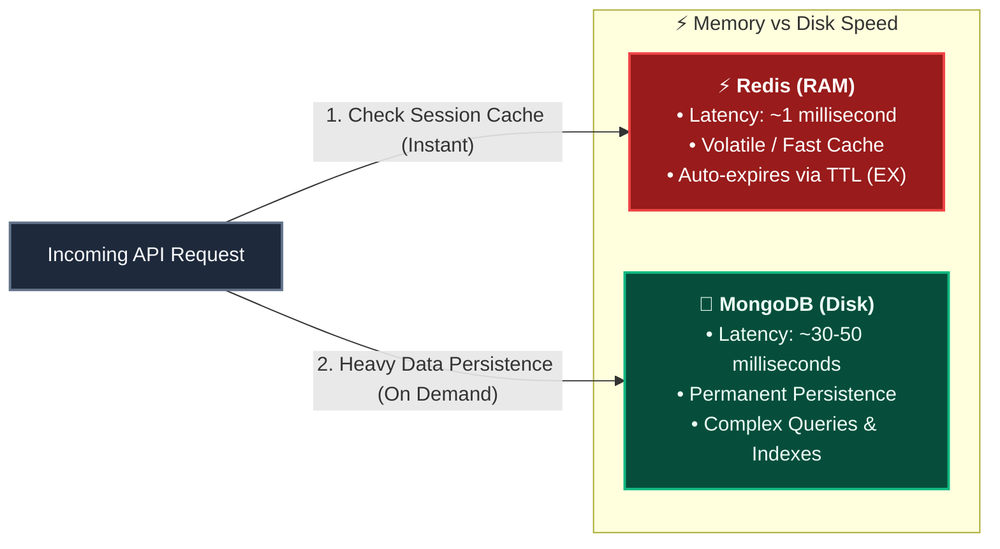

# ⚡ Shared Redis Module — In-Memory High-Speed Cache

> **Port**: `6379` (Runs via Docker Compose)  
> **Role**: Shared In-Memory Session Cache & Fast State Store  
> **Analogy**: Think of MongoDB as the **Heavy Steel File Cabinet in the Basement** (durable, permanent storage on disk, takes ~50ms to read). Redis is the **Post-it Note on the Bouncer's Desk** (kept in ultra-fast RAM, takes ~1ms to glance at). Whenever a user makes an API call, we glance at the Post-it Note first!

---

## 1. Visual Architecture & Speed Comparison



---

## 2. Directory Structure

```
backend/
├── docker-compose.yml        # Docker recipe running Redis 7 Alpine on port 6379
└── shared/
    └── redis/
        ├── redis.js          # Reusable, resilient ioredis connection client
        └── README.md         # This visual guide
```

---

## 3. The Reusable Client (`backend/shared/redis/redis.js`)

Instead of each microservice installing its own Redis package and creating duplicate connections, every service imports this **single shared instance**:

```javascript
import Redis from "ioredis";

const redisUrl = process.env.REDIS_URL || "redis://localhost:6379";

const redis = new Redis(redisUrl, {
  lazyConnect: true,         // Don't crash immediately if Redis is starting up
  connectTimeout: 10000,     // 10s connection timeout
  maxRetriesPerRequest: 3,   // Prevent hanging requests if Redis disconnects
  retryStrategy: (attempt) => Math.min(attempt * 500, 5000), // Exponential backoff
});

redis.on("ready", () => console.log("✅ Redis connected"));
redis.on("error", (err) => console.error("Redis connection error:", err.message));

export default redis;
```

---

## 4. Why `ioredis` Instead of the Default `redis` Package?

1. **Production Resiliency**: `ioredis` includes built-in cluster support, auto-reconnect with custom retry strategies, and pipeline batching.
2. **`lazyConnect: true`**: In microservices, services often boot up in parallel. If Redis takes 2 seconds to launch, `lazyConnect` prevents Express from crashing immediately on boot.
3. **Promise-First**: Every command (`redis.get`, `redis.set`, `redis.del`) natively returns a Promise, making it seamless with `async / await`.

---

## 5. Most Common Redis Operations Used

### 1. Storing a Session with Expiry (`EX`)
```javascript
// Store session token for 7 days (604,800 seconds)
await redis.set(`session:${userId}`, sessionCookie, "EX", 60 * 60 * 24 * 7);
```

### 2. Reading a Session (Sub-millisecond)
```javascript
const session = await redis.get(`session:${userId}`);
if (!session) {
  // Session expired or logged out
}
```

### 3. Deleting a Session on Logout (Instant Invalidation)
```javascript
await redis.del(`session:${userId}`);
```

---

## 6. How to Start Redis Locally

From the `backend/` directory, launch the Redis container:

```bash
cd backend
docker-compose up -d
```

To test if Redis is running, run:
```bash
docker exec -it agentic-redis redis-cli ping
# Response should be: PONG
```

