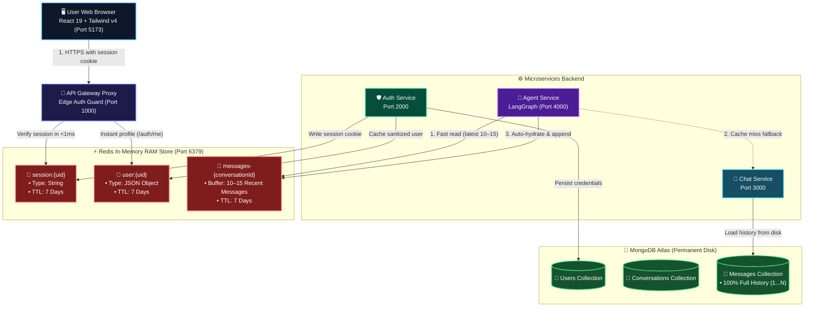
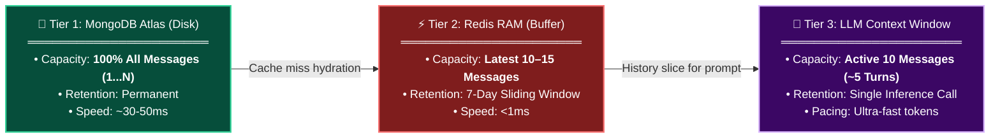

# ⚡ Redis Master Architecture & Data Reference Guide

> **Role**: Ultra-Fast In-Memory Cache, Edge Session Store & Bounded Multi-Agent Conversational Memory  
> **Default Port**: `6379` (Container: `agentic-redis`)  
> **Client**: Shared `ioredis` instance via [`backend/shared/redis/redis.js`](file:///w:/Agentic%20AI/backend/shared/redis/redis.js)  
> **Performance**: Sub-millisecond latency (<1ms) in RAM vs MongoDB disk queries (~30–50ms)

---

## 1. System Topology & Data Flow



---

## 2. All Redis Data Keys & Specifications

| Key Pattern | Data Type | Service Owner | Capacity / Limit | TTL (Expiry) | Purpose |
| :--- | :--- | :--- | :--- | :--- | :--- |
| **`session:${uid}`** | `String` | `auth`, `gateway` | 1 Cookie string | **7 Days** (`604,800s`) | Stores the Firebase session cookie for instant edge verification at the Gateway. |
| **`user:${uid}`** | `JSON Object` | `auth`, `gateway` | 1 Profile object | **7 Days** (`604,800s`) | Caches user profile (id, name, email, avatar) for instant `GET /auth/me` hydration. |
| **`messages-${conversationId}`** | `JSON Array` | `agent` | **Latest 10–15 Messages** | **7 Days** (`604,800s`) | Bounded sliding window buffer of recent turns for multi-agent reasoning context. |

---

## 3. Message Storage Hierarchy: How Many Messages Are Saved?

To balance **infinite history** with **ultra-fast inference and zero memory leaks**, Agentic AI implements a **3-Tier Storage Hierarchy**:



### Why Bounded to 10–15 Messages in Redis?
1. **Zero Memory Bloat**: Capping conversation memory at the latest **10–15 messages** (`MAX_MEMORY_MESSAGES = 15`) keeps Redis key sizes under ~5 KB per conversation.
2. **Sub-millisecond Latency**: Parsing a 10–15 item JSON array in Node.js takes `< 0.05ms`, guaranteeing instant agent graph execution.
3. **Safety Fallback**: If a user returns to a conversation after weeks, the Agent microservice automatically queries the Chat service, pulls from MongoDB, trims the latest 15 messages, and re-hydrates Redis seamlessly.

---

## 4. Deep Dive: Key Payloads & Schemas

### 4.1 `session:${uid}` (Edge Session Cookie)
- **Key Pattern**: `session:4xK9pL2vM8qR...` (Firebase UID)
- **Value**: Raw Firebase session cookie string
- **Lifecycle**:
  - **Created**: During `POST /auth/login` after verifying Firebase Google ID Token.
  - **Read**: On every protected request at the Gateway level (`verifyGatewayAuth`).
  - **Destroyed**: On `POST /auth/logout` via `redis.del("session:" + uid)`.

---

### 4.2 `user:${uid}` (Cached User Profile)
- **Key Pattern**: `user:4xK9pL2vM8qR...`
- **Value**: Stringified JSON object
```json
{
  "id": "672f...",
  "firebaseUid": "4xK9pL2vM8qR...",
  "name": "Alex Developer",
  "email": "alex@example.com",
  "avatar": "https://lh3.googleusercontent.com/a/...",
  "createdAt": "2026-11-04T12:00:00.000Z"
}
```

---

### 4.3 `messages-${conversationId}` (Latest 10–15 Messages Buffer)
- **Key Pattern**: `messages-672fc10a8b1...` (MongoDB Conversation ID or Temp ID)
- **Value**: Bounded array containing the **last 10–15 messages** (`MAX_MEMORY_MESSAGES = 15`):
```json
[
  {
    "role": "user",
    "content": "Tell me about popular historical places in India",
    "createdAt": "2026-11-10T04:45:00.000Z"
  },
  {
    "role": "assistant",
    "content": "### Top Historical Destinations in India\n1. Delhi: Red Fort, Qutub Minar...",
    "createdAt": "2026-11-10T04:45:05.000Z"
  },
  {
    "role": "user",
    "content": "What is the best time of year to visit Agra?",
    "createdAt": "2026-11-10T04:46:00.000Z"
  },
  {
    "role": "assistant",
    "content": "The best time to visit Agra is from October to March...",
    "createdAt": "2026-11-10T04:46:06.000Z"
  }
]
```

---

## 5. Multi-Agent Memory Sequence Diagram

```mermaid
sequenceDiagram
    autonumber
    actor User as 🖥️ Client Web Browser
    participant GW as 🚪 API Gateway (Port 1000)
    participant AG as 🤖 Agent Service (Port 4000)
    participant RD as ⚡ Redis RAM (Port 6379)
    participant CH as 💬 Chat Service (Port 3000)
    participant LLM as 🧠 LLM (Groq / Gemini)

    User->>GW: POST /agent { prompt, conversationId }
    GW->>AG: Forward with validated x-user-id header
    
    rect rgb(30, 41, 59)
        Note over AG,RD: 1. Memory Hydration (&lt;1ms)
        AG->>RD: GET messages-{conversationId}
        alt Cache Hit
            RD-->>AG: Returns latest 10–15 messages array
        else Cache Miss (Expired or First Load)
            AG->>CH: GET /conversations/{id}/messages
            CH-->>AG: Returns all messages from MongoDB
            AG->>RD: SETEX messages-{id} 604800 (Save last 15)
        end
    end

    rect rgb(49, 46, 129)
        Note over AG,LLM: 2. Context Windowing
        AG->>AG: Slice last 10 messages from memory buffer
        AG->>LLM: Invoke with [systemPrompt, ...history, currentPrompt]
        LLM-->>AG: Stream tokens in real-time (SSE)
        AG-->>User: Real-time chunk stream to chat UI
    end

    rect rgb(19, 78, 74)
        Note over AG,RD: 3. Turn Persistence
        AG->>RD: appendMemory(conversationId, [userMsg, assistantMsg])
        Note over RD: Bounds to latest 15 messages & resets 7-Day TTL
    end
```

---

## 6. Shared Client Implementation (`redis.js`)

All microservices (`gateway`, `auth`, `agent`) connect to Redis through a single resilient singleton:

```javascript
// backend/shared/redis/redis.js
import Redis from "ioredis";

const redisUrl = process.env.REDIS_URL || "redis://localhost:6379";

const redis = new Redis(redisUrl, {
  lazyConnect: true,          // Prevents crash if Redis boots 1s slower than Node
  connectTimeout: 10000,      // 10-second connection timeout
  maxRetriesPerRequest: 3,    // Fast fail on network drop
  retryStrategy: (attempt) => Math.min(attempt * 500, 5000), // Exponential backoff
});

redis.on("ready", () => console.log("✅ Redis connected"));
redis.on("error", (err) => console.error("Redis connection error:", err.message));

export default redis;
```

---

## 7. Memory Operations API Reference (`utils/memory.js`)

| Function | Signature | Buffer Rule | Description |
| :--- | :--- | :--- | :--- |
| **`getMemory`** | `(conversationId, userId)` | Up to 15 | Retrieves history from Redis in `<1ms`. If cache miss, loads from Chat microservice, trims to 15, and hydrates Redis. |
| **`setMemory`** | `(conversationId, messages)` | `.slice(-15)` | Serializes and writes message array to Redis with a 7-day TTL (`EX 604800`). |
| **`appendMemory`**| `(conversationId, newMessages)` | `.slice(-15)` | Appends new turns, filters duplicate consecutive queries, trims to 15, and refreshes the 7-day TTL. |
| **`clearMemory`** | `(conversationId)` | Deletes key | Deletes `messages-${conversationId}` when a conversation is deleted. |

---

## 8. CLI Debugging & Live Inspection

Run `redis-cli` inside the Docker container to inspect live keys and data:

```bash
# 1. Open Redis interactive CLI
docker exec -it agentic-redis redis-cli

# 2. View all active keys in RAM
KEYS *

# 3. View user session cookie
GET session:<uid>

# 4. View cached conversation messages (last 10-15)
GET messages-<conversationId>

# 5. Check remaining TTL (time-to-live in seconds)
TTL messages-<conversationId>

# 6. Delete a specific conversation cache
DEL messages-<conversationId>

# 7. Real-time live log stream of all commands executed in Redis
MONITOR

# 8. Check memory usage and stats
INFO memory
```

---

## 9. Core Architectural Guardrails
1. **Never query MongoDB from the API Gateway**: The Gateway only reads `session:${uid}` and `user:${uid}` from Redis RAM.
2. **Chat Service has no Redis dependency**: Chat service owns permanent MongoDB storage (`messages`, `conversations`).
3. **Always enforce a TTL**: Unbounded Redis keys cause Out-Of-Memory (OOM) crashes. Every key uses a 7-day TTL (`604,800s`).
4. **Always bound message arrays**: Redis conversation memory is strictly capped to the **latest 10–15 messages** (`MAX_MEMORY_MESSAGES = 15`), while MongoDB preserves the full infinite history.
