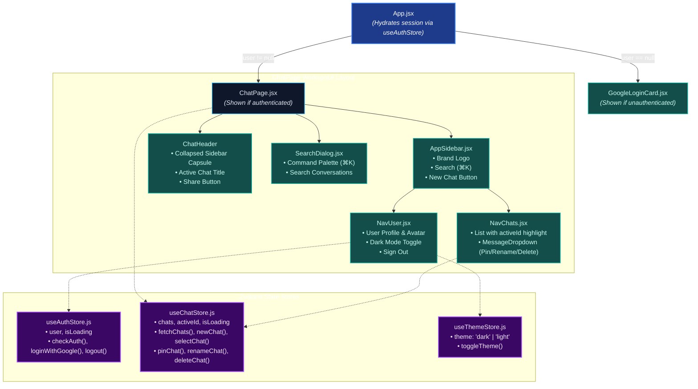

# 🖥️ Frontend — Agentic AI

> **Port**: `5173`  
> **Framework**: React 19 + Vite 8 + Tailwind CSS v4 + Base UI / Shadcn UI + Zustand  
> **Role**: Modern, responsive AI agent chat workspace with optimistic UI updates and instant session hydration.

---

## 1. Visual Component Architecture



---

## 2. Directory Layout

```
frontend/
├── components/
│   ├── ui/                    # Primitive Shadcn / Base UI controls (button, dialog, avatar, sidebar, etc.)
│   ├── app-sidebar.jsx        # Navigation sidebar with brand header and chat lists
│   ├── message-dropdown.jsx   # Context menu for chat actions (Pin, Rename, Delete)
│   ├── nav-chats.jsx          # Conversation list with activeId highlight & pin icons
│   ├── nav-user.jsx           # User profile menu, dark mode toggle, sign out
│   └── search-dialog.jsx      # Command Palette (⌘K) to quickly search and switch chats
├── hooks/
│   ├── use-mobile.js          # useSyncExternalStore responsive viewport detector
│   └── use-highlighted-code.js# Shiki syntax highlighting hook
├── lib/
│   ├── highlighter.jsx        # Shiki core code highlighter
│   └── utils.js               # Tailwind cn helper
├── pages/
│   └── ChatPage.jsx           # Main chat workspace & collapsible sidebar layout
├── store/
│   ├── useAuthStore.js        # User session, Google OAuth & logout
│   ├── useChatStore.js        # Conversations, activeId pointer & optimistic updates
│   └── useThemeStore.js       # Light / Dark theme management
├── utils/
│   ├── axios.js               # Pre-configured Axios instance withCredentials: true (Gateway Port 1000)
│   └── firebase.js            # Firebase client SDK initialization & Google Provider
├── src/
│   ├── App.jsx                # Root router / session gatekeeper
│   ├── main.jsx               # React 19 root
│   └── index.css              # Tailwind CSS v4 variables & typography
├── index.html                 # HTML shell with Geist font
└── vite.config.js             # Vite 8 configuration
```

---

## 3. Global State Architecture (Zustand)

For a complete in-depth guide on state management, see [`STATE_MANAGEMENT_GUIDE.md`](../STATE_MANAGEMENT_GUIDE.md).

### A. `useAuthStore` (Session & Authentication)
* **Session Hydration**: On app startup, `checkAuth()` calls `GET /auth/me`. The API Gateway checks the Redis session in `< 1ms` and hydrates `user`.
* **Google OAuth**: `loginWithGoogle()` triggers Firebase `signInWithPopup`, obtains an ID token, and sends it to `POST /auth/login`.
* **Clean Pattern**: Uses native `finally` to ensure `isLoading: false` is never duplicated.

### B. `useChatStore` (Conversations & Active Selection)
* **The `activeId` Pointer**: Tracks the currently open conversation. Multiple components (`NavChats`, `ChatHeader`, `SearchDialog`) subscribe atomically to `activeId`.
* **Instant Optimistic Updates**:
  - `pinChat(id)`: Flips the pin status in UI immediately, then syncs with `PATCH /chat/conversations/:id`. Reverts via `.catch()` on error.
  - `deleteChat(id)`: Removes chat immediately and jumps `activeId` to the next chat. Reverts via `.catch()` on network failure.
  - `renameChat(id, title)`: Renames title instantly in local state and syncs in background.

---

## 4. Engineering Principles Applied

1. **Atomic Selectors**: Always select specific slices (`const user = useAuthStore(s => s.user)`) to prevent unnecessary component re-renders.
2. **Shadcn UI First**: Reusable primitives from `components/ui/` (`Button`, `DropdownMenu`, `Avatar`, `Sidebar`, `Dialog`) instead of ad-hoc HTML.
3. **No Premature Abstractions**: We avoid complex wrapper classes. State actions use native JavaScript `try ... finally` and promise `.catch()` rollbacks.
4. **Modern React 19**: Viewport listening uses `useSyncExternalStore` instead of `useEffect` with synchronous `setState`.

---

## 5. Development & Running

```bash
# 1. Install dependencies
cd frontend
npm install

# 2. Run development server (Port 5173)
npm run dev

# 3. Run ESLint check
npm run lint

# 4. Create production build
npm run build
```
